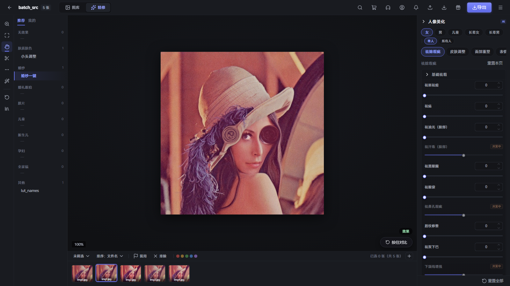

# PixLite

**本地运行的 AI 人像精修工作台，面向飞牛 fnOS NAS。** 浏览器打开即用，照片和模型都不出 NAS。

> 当前为 **Beta** 版（`v0.1.12-beta.4`）。功能和界面对标像素蛋糕 10.0.5 的人像精修流程，仍有部分功能未实现（见[已知限制](#已知限制)）。欢迎在 [Issues](https://github.com/pm-parker/pixlite/issues) 反馈问题。



## 功能

| 类别 | 内容 |
|---|---|
| 人像美化 | 祛斑祛痘、祛痣、祛油光、祛黑眼圈、祛眼袋、眼白净化、祛红血丝、唇纹修整、祛双下巴、面部祛纹 9 项、磨皮、肤色（提亮/美白/红润/肤色统一）、GFPGAN 面部修复 |
| 五官与形体 | 瘦脸 / 小头等面部重塑、自动液化、亮眼、眼神光、祛双眼皮贴、眼镜祛反光、微笑嘴角、笑容管理、露龈调整、牙齿美白 / 排齐 / 祛瑕疵、瘦腰、瘦腿、长腿、祛副乳、祛妊娠纹 |
| 头发与妆容 | 祛碎发、头发柔顺、发缝填充、颅顶调整、发量、发色调整 / 统一、祛白发；高光 / 阴影立体、眉毛 / 眼妆 / 唇妆增强；24 套整套妆容；AI 妆容迁移（BeautyGAN） |
| 调色 | 白平衡、影调（曝光、对比、亮度、高光、阴影、白色、黑色、纹理、清晰度、祛雾、鲜艳度、饱和度）、HSL 8 色、色彩编辑器、曲线、色阶、颜色分级、可选颜色、颗粒、AI 追色 |
| 滤镜与背景 | 92 个 LUT 滤镜（三线性插值）、配置文件（标准 / 质感 / 黑白 / 基础）、背景虚化 / 换纯色（MODNet 抠像）、天空替换（日落 / 晴空 / 黄昏 / 阴天）/ 增强、Real-ESRGAN 画质修复 |
| 工作流 | 项目管理、星级 / 留用 / 色标筛选、按住对比、撤销重做（Ctrl+Z）、52 个场景预设（婚纱、儿童、孕妇、新生儿、全家福、胶片等 9 类）、人物属性（女 / 男 / 儿童 / 长辈，多人照片逐脸识别）、EXIF 读取、单张 / 全部导出 |
| 批量 | 整个目录递归批量精修，可选套用预设或工作台里调好的参数，保留目录结构，支持断点续跑和取消；支持 JPG / PNG / WebP / BMP / TIFF 和 DNG / CR2 / CR3 / ARW / NEF / RAF / ORF / RW2 等 RAW 格式 |
| 加速 | CPU 默认可用；自动探测 NVIDIA CUDA、AMD MIGraphX / ROCm、Intel OpenVINO（Windows 上为 DirectML），失败时回退 CPU |

所有效果都在本地运行（OpenCV + onnxruntime），不调用任何云端服务。滑杆与引擎算法的对应关系见 [CAPABILITY_MAP.md](CAPABILITY_MAP.md)。

## 在飞牛 fnOS 上安装

1. 在应用中心安装 **python312** 运行时（PixLite 依赖它）。
2. 从 [Releases](https://github.com/pm-parker/pixlite/releases) 下载安装包，二选一：

   | 安装包 | 大小 | 适用 |
   |---|---|---|
   | `fnnas.pixlite_<版本>_full.fpk` | 约 750 MB | 内置全部 AI 模型，装完即可精修；NAS 不能联网时选这个 |
   | `fnnas.pixlite_<版本>.fpk` | 约 30 MB | 精简包，首次启动后自动下载模型（约 790 MB） |

3. 应用中心 → 手动安装 → 选择 `.fpk`。安装向导里可选择 GPU 加速方式，默认「自动探测」即可。
4. 安装完成后点飞牛桌面的 **PixLite 修图** 图标打开。

安装后不需要任何手动配置：

- **不需要密钥**：桌面图标走飞牛的[统一网关](https://developer.fnnas.com/docs/core-concepts/gateway-registration/)（`/app/fnnas-pixlite/`，以飞牛窗口内嵌方式打开），飞牛先校验 NAS 登录，已登录的用户直接可用。
- **模型自动下载**：精简包首次启动后在后台下载模型，页面底部显示进度和剩余时间。下载期间可以先浏览和整理照片，下载完成后精修自动可用。中文系统优先使用 hf-mirror.com，支持断点续传和多源切换，每个文件都做 sha256 校验；失败时每 5 分钟自动重试，也可以点「立即重试」。
- **升级保留数据**：模型保存在应用数据目录 `var/models`，项目数据在浏览器本地，升级应用不需要重新下载。

> 安装时需要联网：安装脚本会在 NAS 上创建 Python 虚拟环境，并从 PyPI 安装 onnxruntime、OpenCV 等依赖。

### 直接访问端口（可选）

也可以用 `http://<NAS IP>:8300` 直接访问，例如从其他设备或脚本调用 API。这种访问方式不经过飞牛登录，需要连接密钥：

- 密钥在首次启动时自动生成（32 字节随机值）。
- 管理员从桌面图标打开 PixLite 后，点击左下角 **直连密钥** 即可复制。
- 在直连页面首次打开时会弹出输入框，填入密钥即可；API 调用时放在请求头 `X-API-Key`。

## 其他运行方式

### Docker

```bash
docker build -f docker/Dockerfile -t pixlite .
docker run -p 8900:8900 \
  -e PIXLITE_TOKEN=<自己生成的长随机字符串> \
  -v pixlite-data:/data \
  -v /path/to/photos:/photos \
  pixlite
```

浏览器打开 `http://<主机>:8900`，填入 `PIXLITE_TOKEN` 作为连接密钥。模型首次启动时自动下载到 `/data/models`；构建时加 `--build-arg WITH_MODELS=1` 可把模型打进镜像。照片目录需要挂载到 `/photos`（或用 `PIXLITE_ALLOWED_ROOTS` 指定）。

### 本地开发

需要 Python 3.12+ 和 Node 22+。

```bash
python -m pip install -r requirements-dev.txt
(cd webapp && npm ci && npm run build)      # 前端构建到 server/web
python -m server.run --port 8300            # 模型会在后台自动下载
```

本机（127.0.0.1）访问不需要密钥。前端开发可在 `webapp/` 下运行 `npm run dev`（端口 5180，API 代理到 8300）。

## 访问与安全

| 访问方式 | 认证 |
|---|---|
| 飞牛桌面图标（统一网关 → Unix Socket `app.sock`） | 飞牛校验 NAS 登录，无需密钥 |
| 本机 `127.0.0.1` | 无需密钥 |
| 其他地址访问 TCP 端口 | 必须带 `X-API-Key`；未配置 `PIXLITE_TOKEN` 时一律拒绝 |

- 是否走网关，按连接是从哪个监听端点进来的判断，不看请求头；TCP 端口上伪造的 `X-Trim-*` 网关头会被剥离。
- 所有接收服务器路径的接口（目录浏览、读图、EXIF、批量、追色参考图）都要求路径解析后位于 `PIXLITE_ALLOWED_ROOTS` 内，可防 `../` 和符号链接逃逸。
- 有上传大小、像素数、并发任务数、单批文件数上限，work 目录按 72 小时自动清理。

## 配置项

飞牛安装包已自动设置好这些变量，一般不需要修改。

| 环境变量 | 默认值 | 说明 |
|---|---|---|
| `PIXLITE_TOKEN` | 空 | 直连端口的访问密钥；fnOS 首次启动自动生成 |
| `PIXLITE_ALLOW_NO_TOKEN` | `0` | 设为 `1` 时允许无密钥远程访问（仅限可信内网） |
| `PIXLITE_GATEWAY_SOCKET` | 空 | 飞牛统一网关的 Unix Socket 路径（fnOS：`${TRIM_APPDEST}/app.sock`） |
| `PIXLITE_ALLOWED_ROOTS` | `/vol*`、`/var/apps/fnnas.pixlite/share`、`/share`、`/mnt`、`/media`、`/home` 中存在的目录，加上 work 目录 | 允许访问的照片根目录，用系统路径分隔符分隔 |
| `PIXLITE_MODELS_DIR` | `engine/perception/models` | 模型下载目录（fnOS：`var/models`） |
| `PIXLITE_AUTO_DOWNLOAD_MODELS` | `1` | 启动时自动下载缺失模型 |
| `PIXLITE_MODEL_MIRROR_FIRST` | 中文系统为 `1` | 优先使用 hf-mirror.com 等镜像源 |
| `PIXLITE_EP` | `auto` | 推理后端：`auto` / `cpu` / `cuda` / `rocm` / `migraphx` / `openvino` / `dml` |
| `PIXLITE_WORK_DIR` | `server/work` | 上传和结果临时目录 |
| `PIXLITE_LUT_DIR` | 安装包内 `lut/Filters` | LUT 滤镜目录 |
| `PIXLITE_MAX_UPLOAD_MB` | `200` | 单文件上传上限 |
| `PIXLITE_MAX_PIXELS` | `100000000` | 解码前的像素数上限 |
| `PIXLITE_MAX_ACTIVE_JOBS` / `PIXLITE_MAX_ACTIVE_BATCHES` | `4` / `1` | 同时运行的单图 / 批量任务数 |
| `PIXLITE_MAX_BATCH_FILES` / `PIXLITE_MAX_BATCH_WORKERS` | `5000` / `8` | 单批文件数 / 批量线程上限 |
| `PIXLITE_JOB_TTL_HOURS` | `72` | work 目录产物保留时长 |

## AI 模型

8 个公开开源模型，共约 790 MB，固定到不可变的版本，并逐个校验 size 和 sha256（清单见 `engine/perception/models_manifest.py`）。

| 模型 | 用途 |
|---|---|
| YuNet | 人脸检测 |
| MediaPipe Face Landmarker（ONNX 版） | 478 点人脸关键点 |
| SegFormer face-parsing | 皮肤、五官、头发、衣物分割 |
| insightface genderage | 性别 / 年龄识别（人物属性） |
| GFPGAN 1.4 | 面部修复 |
| Real-ESRGAN x2 | 画质修复 |
| MODNet | 人像抠图（背景虚化 / 换色） |
| BeautyGAN | 妆容迁移 |

手动下载（CI 构建 full 包、离线预置或排障时使用）：

```bash
python tools/download_models.py            # 下载到 engine/perception/models
python tools/download_models.py --mirror   # 优先走镜像
python tools/download_models.py --verify   # 只校验已有文件
```

## 架构

```
webapp/            Vue 3 + Element Plus 前端，构建到 server/web
server/run.py      启动入口：一个 uvicorn 同时监听 TCP 端口和飞牛网关 Unix Socket
server/api/        FastAPI：鉴权、精修任务、批量、目录浏览、模型状态
engine/perception  人脸检测、478 点关键点、人脸解析、性别年龄、模型下载与校验
engine/effects     磨皮、祛瑕、五官、牙齿、头发、妆容、身体、背景、天空、画质
engine/warp        MLS 变形（瘦脸、面部重塑、液化、微笑）
engine/color       LUT、白平衡、影调、HSL、曲线、色阶、颜色分级、追色
engine/pipeline    按预设 JSON 执行节点链，处理人群路由与参数系数
presets/           场景预设、妆容配方、滤镜名称
fnpack/            飞牛安装包：manifest、生命周期脚本、安装向导、打包脚本
```

一次精修的流程：前端把滑杆值转换为引擎参数 → `POST /api/retouch` → 服务端在预设节点链上合并参数 → 后台线程执行 → 前端轮询 `/api/job/{id}` → 取回 `/api/result/{id}`。

## 开发与测试

```bash
python -m pytest -q             # 73 条单元 / API / 网关 / 模型下载测试；缺模型的用例自动跳过
python tests/run_e2e_c.py       # 端到端：28 个效果逐个开启，结果必须与基线不同（需要模型）
python tests/run_out_c.py       # 单效果验证（需要模型）
```

两个端到端脚本在有失败项时以非零退出码结束。

## 打包与发布

`.github/workflows/build-fpk.yml` 用飞牛官方 [fnpack](https://developer.fnnas.com/docs/cli/fnpack/) 1.2.3（按 sha256 固定）自动打包：

| 触发 | 产物 |
|---|---|
| push 到 `main` / PR | 跑测试，打精简包，作为 Actions 产物保留 30 天 |
| 手动运行（勾选 `with_models`） | 精简包 + 内置模型的 `_full.fpk` |
| 推送 tag `vX.Y.Z` 或 `vX.Y.Z-beta.N` | 两个包都打，并发布到 GitHub Release；带 `-beta` / `-rc` 等后缀的 tag 发布为预发布版 |

本地打包：

```bash
python fnpack/build_pkg.py --fnpack /path/to/fnpack [--with-models] [--version 0.1.12-beta.4]
```

产物输出在 `dist/`。脚本会先构建前端，再组装飞牛要求的目录结构（`app/` 和 `app/ui/config`），并校验入口配置、前端文件和 LUT 是否齐全。

## 已知限制

- **尚未在飞牛真机上完整验证**：统一网关入口按[官方文档](https://developer.fnnas.com/docs/core-concepts/gateway-registration/)实现，生命周期脚本在本地模拟环境下测试通过。较老的 fnOS 版本如果不支持统一网关，桌面图标可能打不开，这时可以用直连端口访问。
- **仅支持 x86**：`manifest` 中 `platform = x86`。
- **部分功能未实现**：界面中标「开发中」的项目需要云端大模型或额外的分割模型，目前置灰，包括 AI 祛纹身、AI 祛体毛、手部 / 脚部美型、AI 塑形、瘦手臂、直角肩等，详见 [CAPABILITY_MAP.md](CAPABILITY_MAP.md)。
- **多人照片**：每张脸都会单独识别人群，但效果参数按整张图统一应用。混合人群（例如新人和长辈的合影）时会回退为默认参数，不会按每个人分别调整；人物属性里的「单人 / 所有人」作用范围也尚未实现（界面置灰）。
- **多图色彩统一**：尚未实现（界面置灰），可先用 AI 色彩的参考图追色逐张统一。
- **身体类效果**：用衣物 / 颈部分割区域近似身体轮廓，在头像特写上效果有限。
- **CPU 性能**：在没有 GPU 的 NAS 上，含 GFPGAN 的预设单张需要数秒到数十秒。

## 更新记录

修复和改进的明细见 [BUGFIX_REPORT.md](BUGFIX_REPORT.md)。

- **0.1.12-beta.4**：右侧「图像」板块（画质修复、背景虚化、天空增强 / 替换）可用；配置文件接入引擎；批量精修可套用工作台参数；批量和新建项目的预设下拉不再为空；修复头发柔顺报错；作用范围、多图色彩统一改标「开发中」。
- **0.1.12-beta.3**：飞牛桌面入口改为 iframe、网关前缀改为 `/app/fnnas-pixlite`（beta.1 / beta.2 点击桌面图标会 404）。
- **0.1.12**：从飞牛桌面图标打开即用（飞牛登录自动认证，不需要连接密钥）；精简包首次启动后台自动下载模型并显示进度；GitHub Actions 自动构建 `.fpk`。
- **0.1.11**：修复 Issue #1–#12：鉴权改为默认拒绝、文件访问白名单、资源上限、模型版本固定和 sha256 校验、多人逐脸识别、可复现的 Docker 和打包构建等。
- **0.1.10**：修复 26 个缺陷：478 点关键点失效、LUT 按坐标查表、肤色被抹成灰、白平衡方向错误、HSL 只覆盖半个色环等。
